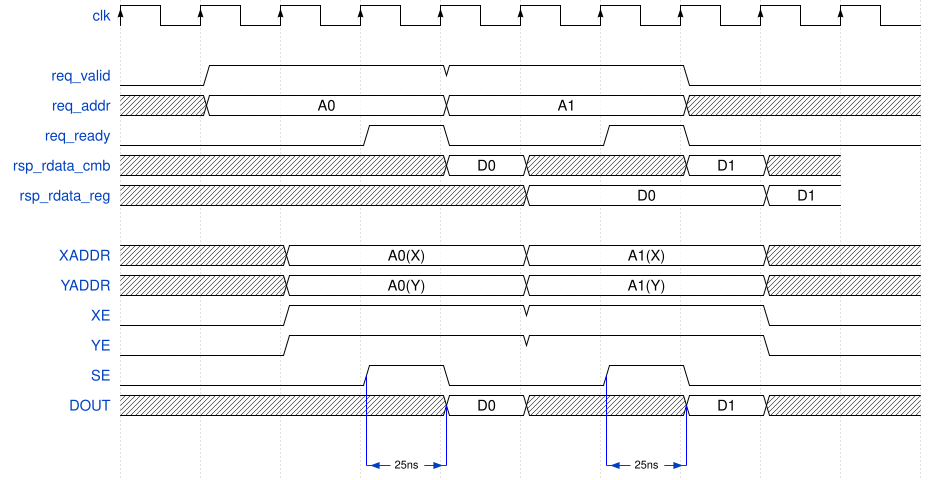
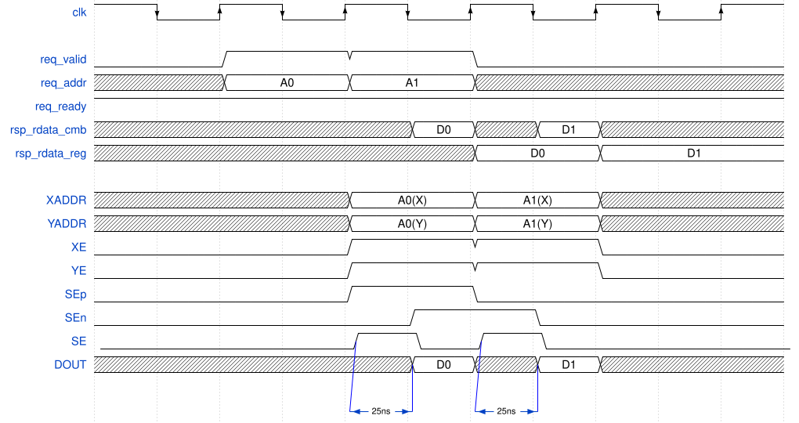

# Embedded flash controller

In the current state this are more like instructions on how to build your custom
embedded flash controller than a parameterized general purpose IP block.

## System bus protocol

The system bus protocol is a combination of the VALID/READY handshake
and SRAM access timing, with the exception that write access is not implemented.

The VALID signal indicates a request and the address must be stable
through the entire valid period.

The READY signal would generally be used either by a subordinate
to extend the access to a slow peripheral (in this case),
or the interconnect to indicate when the arbiter
is giving access to the observed manager.

The described Flash controllers all follow a similar principle to SRAM (synchronous RAM),
The setup timing for the address is low and
read data is available after the rising edge of the clock (after a clock to output delay).

The low setup timing is achieved by registering the request address signals withing the controller.

In **combinational** mode, similar to SRAM access timing,
the Flash read data is available after a clock to data valid delay.
This delay is small for FPGA BSRAM (_3.46ns_) but large for the embedded flash (_25ns_).

In **registered** mode, there read data signals are registered,
thus delaying the data for another clock cycle in relation to the handshake.
This is similar to enabling the read data register for BSRAM.

## Flash protocol

For all discussed controller implementations the `XADDR`/`YADDR` registered
and at the same clock edge `XE`/`YE` are driven high.

The read data signal can be either forwarded combinationaly to the rest of the SoC,
In this case the setup delay within the SoC must be added to the Flash access time (_25ns_)
when calculating the maximum clock frequency.

As an alternative, the read data signals can be registered within the controller.
In this case the controller timing can be calculated manually,
while for the rest of the SoC the timing can be just a simple clock period constraint.

### Common approach

The common approach is to handle all protocol timing requirements
using one or more clock periods and to register the read data path.

All timing requirements are fulfilled with one or more clock period states:
* `IDLE`: the address enable signals `XE`/`YE` are low,
  Gowin documentation does not specify a minimum or maximum time.
  _Tnws_` (SE pulse low level time) is just _2ns_,
  so a single clock period is enough for up to a 500MHz clock.
* `ADDR`: at the beginning the `XADDR`/`YADDR` address signals become valid and
  address enable signals `XE`/`YE` become active.
  _Tas_ (time from address and `XE`/`YE` pos-edge to `SE` pose-edge) is just _0.1ns_,
  so a single clock period is always enough.
* `DETECT`: the `SE` pulse must be at least _5ns_ long,
  a single clock period is enough for up to a _200MHz_ clock speed.
* `DATA`: state can be from 0 to many clock cycles depending on the clock frequency.
  The length of `DETECT`+`DATA` states must be at least _Tacc_ (access time).
  In case of a registered read path at least _25ns_,
  in case of a combinational path, the setup delay within the SoC must be added.
* After the `XE`/`YE` transition to low, the data is only valid for _Tdh_ (data hold time),
  at _0.5ns_ it should be enough for FPGA register hold requirements.


### Removing the idle state

The timing diagrams in the Gowin device documentation seem to indicate,
`SE` pulses can be issued without lowering the address enable signals `XE`/`YE`.
Unfortunately the address signals `XADDR`/`YADDR` in the diagram remain unchanged,
so the documentation is not clear.

So I guessed address enable gaps are not really necessary,
I removed them from the controller state machine and tested the setup.
Again unfortunately the Flash model does not support this,
so I was only able to test this on the actual running hardware using the demo design.

While the demo apparently works as I would have hoped,
there could still be unexpected side effect affecting Flash reliability.
I would need the full embedded flash documentation from the manufacturer (TSMC 55nm).



### Removing the `SE` setup state

Since the _Tas_ (time from address and `XE`/`YE` pos-edge to `SE` pose-edge) is just _0.1ns_,
it can be implemented with some combinatorial logic delay (`LUT4` in this design)
instead of a full clock period. This saves another clock period
not going toward the Flash access time.

If the `SE` high pulse is a full clock period long,
there must be at least another state where `SE` is low.


**WARNING:** The propagation delay of a `LUT4` (input I0) is about _250ps_,
while interconnect delays can be larger (_500ps_).
So the proper timing might depend on logic placement and routing.
To reliably (repeatably) solve this issue, controller logic locations should be constrained.

### Half period `SE` pulse

The `SE` pulse length can be reduced to a half clock period.
The solution given here is to have a positive clocked `SEp` signal
togling each system bus access cycle and a negatively clocked `SEn` signal
following the positive one.
The `SE` signal is obtaining by XOR-in the positive/negative signals.
The XOR implementation with `LUT4` provides enough propagation delay
to cover the _Tas_ requirement.

This protocol configuration allows for a single clock cycle access to the Flash
at up to 100MHz (`SE` high pulse must be at lest _5ns_ log).
But since above _40MHz_ the access time is already at 2 clock periods,
the previous configuration makes more sense (it is simpler).



NOTE: With combinational logic the possibility of
[glitches](https://en.wikipedia.org/wiki/Race_condition) should be considered.
A glitch can occur when a signal is split,
propagated through separate paths with different delays and later recombined.
Based on my understanding of Gowin `LUT4` logic, glitches should not be a problem.

WARNING: the same warning about interconnect timing repeatability applies here.

### Address prediction/prefetch

In case of a registered read data configuration the read data
is delayed 2 clock periods compared to the handshake,
which is not ideal for a tightly coupled system bus.

Since most access patterns are sequential,
a controller can increment the request address and prefetch the next address.
If the next system bus request address matches the prediction the response
can take a single cycle, if the address does not match the prediction,
the request takes another clock cycle.

## Conclusions

Recommendations ...

## APPENDIX: Test demo

The demo is designed for the **Tang Nano 9k** board
(608kb or 76kB of Flash memory).

A few notes on the RTL design:
* The Flash control signals `[X/Y]E`, `SE` and `VALID`/`READY` are encoded into the FSM states themselves,
  since only 4 signals control the FSM, all can be implemented using only LUT4.
  So there is the FSM does not consume any additional logic.
* While the controller could be tested using a RISC-V CPU,
  I thought it would be easier writing a custom FSM for the demo,
  than finding a simple RISC-V CPU performing back to back reads each clock period.

The controller and demo code can be found in:
* RTL: `hdl/rtl/flash`,
* testbench: `hdl/tbn/flash`.

The system clock is _27MHz_ (directly from the `XTAL_IN` input).
I did not test with other clock frequencies yet,
a PLL could be added for further testing at a broader frequency range.

A reset pulse is created at power-up using the button `S[1]` debouncer.

A Flash readout sequence can be triggered by pressing `S[2]`,
or by sending any character over USB UART.
The readout sends out to USB UART (115200 baudrate).

The readout is done by reading 4kB blocks (for a total of 19 blobks)
of Flash contents into a SRAM buffer,
then sending the data from the buffer to a host over USB UART.
Flash reads are 32bit wide back to back transfers (1k transfers per block).

The default parameter setting is the 1 clock period protocol,
for testing (simulating) other protocol configurations,
change the [protocol cycle length at the controller instance](https://github.com/jeras/tangnano9k-SoC/blob/main/hdl/rtl/flash/tang_nano_9k_flash_demo.sv#L192).

### Simulating

**WARNING:** Do not expect correct behavior from the official
`FLASH608K` Flash model packed with Gowin IDE.
The hardware test still works properly.

Clone the projects and submodules and enter the simulation folder:
```sh
git clone --recursive git@github.com:jeras/tangnano9k-SoC.git
cd tangnano9k-SoC
cd sim/flash
```

Creating a user Flash content file (a binary file, containing text):
```sh
./incrementing_lines.py
```

Simulate using _Icarus Verilog_ (testing using a Git HEAD build of Icarus Verilog):
```sh
./simulate-iverilog.sh
```

To observe the FST waveforms using `surfer` do:
```sh
surfer tangnano9k_flash_demo_tb.fst
```

Simulate using _Questa_:
```sh
./simulate-questa.sh
```

### Synthesis

A Gowin IDE project can be found in the `fpga/flash` folder.

**WARNING:** I did not run synthesis with Yosys yet.

### FPGA board programming

Enter the simulation folder and generate the user Flash contents file:
```sh
cd sim/flash
./incrementing_lines.py
```

Programming both the FPGA bitstream Flash and user Flash.
```sh
openFPGALoader -b tangnano9k -f ../../fpga/flash/impl/pnr/tangnano9k_flash_demo.fs --user-flash incrementing_lines.txt
```

Programming the FPGA bitstream into Flash, keeping the user Flash unchanged:
```sh
openFPGALoader -b tangnano9k -f ../../fpga/flash/impl/pnr/tangnano9k_flash_demo.fs
```

Programming the FPGA bitstream into SRAM, keeping the user Flash unchanged:
```sh
openFPGALoader -b tangnano9k -m ../../fpga/flash/impl/pnr/tangnano9k_flash_demo.fs
```

### Live hardware testing

Read flash contents with a shell script (WARNING: it is not working):
```sh
./flash_readout.sh /dev/ttyUSB1 flash_contents.txt
```

Read flash contents with a Python script (with TTY device and output file as arguments):
```sh
./flash_readout.py /dev/ttyUSB1 flash_contents.txt
```

Check the user Flash contents:
```sh
diff flash_contents.txt incrementing_lines.txt
```

## APPENDIX: Placement

NOTES:
* With the current RTL, Gowin IDE combines the Flash `XE`/`YE` signal
  with the BSRAM write enable signal and places it in the middle of the chip.
  If I place the `XE`/`YE` DFF into the R2C2 corner where the Flash connections are,
  I might have to explicitly allow for duplication of this DFF.

```
ipdb> db.extra_func[0, 0]['userflash']
{
    'type': 'FLASH608K',
    'outs': {
        'DOUT0': 'F1',
        'DOUT1': 'F2',
        'DOUT2': 'F3',
        'DOUT3': 'F6',
        'DOUT4': 'F7',
        'DOUT5': 'OF0',
        'DOUT6': 'OF1',
        'DOUT7': 'OF2',
        'DOUT8': 'OF3',
        'DOUT9': 'OF4',
        'DOUT10': 'OF5',
        'DOUT11': 'OF6',
        'DOUT12': 'OF7',
        'DOUT13': 'USERFLASHDOUT13Q5',
        'DOUT14': 'USERFLASHDOUT14Q6',
        'DOUT15': 'USERFLASHDOUT15Q7',
        'DOUT16': 'USERFLASHDOUT16F0',
        'DOUT17': 'USERFLASHDOUT17F1',
        'DOUT18': 'USERFLASHDOUT18F2',
        'DOUT19': 'USERFLASHDOUT19F3',
        'DOUT20': 'USERFLASHDOUT20F4',
        'DOUT21': 'USERFLASHDOUT21F5',
        'DOUT22': 'USERFLASHDOUT22F6',
        'DOUT23': 'USERFLASHDOUT23F7',
        'DOUT24': 'USERFLASHDOUT24Q0',
        'DOUT25': 'USERFLASHDOUT25Q1',
        'DOUT26': 'USERFLASHDOUT26Q2',
        'DOUT27': 'USERFLASHDOUT27Q3',
        'DOUT28': 'USERFLASHDOUT28Q4',
        'DOUT29': 'USERFLASHDOUT29F7',
        'DOUT30': 'USERFLASHDOUT30F5',
        'DOUT31': 'USERFLASHDOUT31F4'
    },
    'ins': {
        'DIN0': 'USERFLASHDIN0C0',
        'DIN1': 'USERFLASHDIN1C1',
        'DIN2': 'USERFLASHDIN2C2',
        'DIN3': 'USERFLASHDIN3C3',
        'DIN4': 'USERFLASHDIN4C4',
        'DIN5': 'USERFLASHDIN5C5',
        'DIN6': 'USERFLASHDIN6C6',
        'DIN7': 'USERFLASHDIN7C7',
        'DIN8': 'USERFLASHDIN8A6',
        'DIN9': 'USERFLASHDIN9A7',
        'DIN10': 'USERFLASHDIN10A5',
        'DIN11': 'USERFLASHDIN11A4',
        'DIN12': 'USERFLASHDIN12A3',
        'DIN13': 'USERFLASHDIN13A2',
        'DIN14': 'USERFLASHDIN14A1',
        'DIN15': 'USERFLASHDIN15A0',
        'DIN16': 'USERFLASHDIN16B7',
        'DIN17': 'USERFLASHDIN17B6',
        'DIN18': 'USERFLASHDIN18B5',
        'DIN19': 'USERFLASHDIN19B4',
        'DIN20': 'USERFLASHDIN20B3',
        'DIN21': 'USERFLASHDIN21B2',
        'DIN22': 'USERFLASHDIN22B1',
        'DIN23': 'USERFLASHDIN23B0',
        'DIN24': 'USERFLASHDIN24D7',
        'DIN25': 'USERFLASHDIN25D6',
        'DIN26': 'USERFLASHDIN26D5',
        'DIN27': 'USERFLASHDIN27D4',
        'DIN28': 'USERFLASHDIN28D3',
        'DIN29': 'USERFLASHDIN29D2',
        'DIN30': 'USERFLASHDIN30D1',
        'DIN31': 'USERFLASHDIN31D0',
        'XE': 'A1',
        'YE': 'A2',
        'SE': 'A0',
        'PROG': 'A3',
        'ERASE': 'C6',
        'NVSTR': 'C7',
        'XADR0': 'D5',
        'XADR1': 'D4',
        'XADR2': 'D3',
        'XADR3': 'D2',
        'XADR4': 'D1',
        'XADR5': 'D0',
        'XADR6': 'D6',
        'XADR7': 'B1',
        'XADR8': 'B0',
        'YADR0': 'B7',
        'YADR1': 'B6',
        'YADR2': 'B5',
        'YADR3': 'B4',
        'YADR4': 'B3',
        'YADR5': 'B2',
        'INUSEN': 'C0'
    }
}
```

```
ipdb> find_node_key('FLASH_OUT')
* X0Y0/USERFLASHDOUT13Q5 ('FLASH_OUT', {(0, 0, 'USERFLASHDOUT13Q5'), (9, 46, 'Q5')})
* X0Y0/USERFLASHDOUT14Q6 ('FLASH_OUT', {(0, 0, 'USERFLASHDOUT14Q6'), (9, 46, 'Q6')})
* X0Y0/USERFLASHDOUT15Q7 ('FLASH_OUT', {(0, 0, 'USERFLASHDOUT15Q7'), (9, 46, 'Q7')})
* X0Y0/USERFLASHDOUT16F0 ('FLASH_OUT', {(0, 0, 'USERFLASHDOUT16F0'), (9, 46, 'F0')})
* X0Y0/USERFLASHDOUT17F1 ('FLASH_OUT', {(0, 0, 'USERFLASHDOUT17F1'), (9, 46, 'F1')})
* X0Y0/USERFLASHDOUT18F2 ('FLASH_OUT', {(9, 46, 'F2'), (0, 0, 'USERFLASHDOUT18F2')})
* X0Y0/USERFLASHDOUT19F3 ('FLASH_OUT', {(9, 46, 'F3'), (0, 0, 'USERFLASHDOUT19F3')})
* X0Y0/USERFLASHDOUT20F4 ('FLASH_OUT', {(9, 46, 'F4'), (0, 0, 'USERFLASHDOUT20F4')})
* X0Y0/USERFLASHDOUT21F5 ('FLASH_OUT', {(0, 0, 'USERFLASHDOUT21F5'), (9, 46, 'F5')})
* X0Y0/USERFLASHDOUT22F6 ('FLASH_OUT', {(0, 0, 'USERFLASHDOUT22F6'), (9, 46, 'F6')})
* X0Y0/USERFLASHDOUT23F7 ('FLASH_OUT', {(0, 0, 'USERFLASHDOUT23F7'), (9, 46, 'F7')})
* X0Y0/USERFLASHDOUT24Q0 ('FLASH_OUT', {(0, 0, 'USERFLASHDOUT24Q0'), (9, 46, 'Q0')})
* X0Y0/USERFLASHDOUT25Q1 ('FLASH_OUT', {(0, 0, 'USERFLASHDOUT25Q1'), (9, 46, 'Q1')})
* X0Y0/USERFLASHDOUT26Q2 ('FLASH_OUT', {(9, 46, 'Q2'), (0, 0, 'USERFLASHDOUT26Q2')})
* X0Y0/USERFLASHDOUT27Q3 ('FLASH_OUT', {(9, 46, 'Q3'), (0, 0, 'USERFLASHDOUT27Q3')})
* X0Y0/USERFLASHDOUT28Q4 ('FLASH_OUT', {(0, 0, 'USERFLASHDOUT28Q4'), (9, 46, 'Q4')})
* X0Y0/USERFLASHDOUT29F7 ('FLASH_OUT', {(0, 0, 'USERFLASHDOUT29F7'), (0, 46, 'F7')})
* X0Y0/USERFLASHDOUT30F5 ('FLASH_OUT', {(0, 0, 'USERFLASHDOUT30F5'), (0, 46, 'F5')})
* X0Y0/USERFLASHDOUT31F4 ('FLASH_OUT', {(0, 46, 'F4'), (0, 0, 'USERFLASHDOUT31F4')})
```

```
ipdb> find_node_key('FLASH_IN')
* X0Y0/USERFLASHDIN0C0 ('FLASH_IN', {(0, 0, 'USERFLASHDIN0C0'), (9, 46, 'C0')})
* X0Y0/USERFLASHDIN1C1 ('FLASH_IN', {(0, 0, 'USERFLASHDIN1C1'), (9, 46, 'C1')})
* X0Y0/USERFLASHDIN2C2 ('FLASH_IN', {(9, 46, 'C2'), (0, 0, 'USERFLASHDIN2C2')})
* X0Y0/USERFLASHDIN3C3 ('FLASH_IN', {(9, 46, 'C3'), (0, 0, 'USERFLASHDIN3C3')})
* X0Y0/USERFLASHDIN4C4 ('FLASH_IN', {(0, 0, 'USERFLASHDIN4C4'), (9, 46, 'C4')})
* X0Y0/USERFLASHDIN5C5 ('FLASH_IN', {(0, 0, 'USERFLASHDIN5C5'), (9, 46, 'C5')})
* X0Y0/USERFLASHDIN6C6 ('FLASH_IN', {(0, 0, 'USERFLASHDIN6C6'), (9, 46, 'C6')})
* X0Y0/USERFLASHDIN7C7 ('FLASH_IN', {(0, 0, 'USERFLASHDIN7C7'), (9, 46, 'C7')})
* X0Y0/USERFLASHDIN8A6 ('FLASH_IN', {(9, 46, 'A6'), (0, 0, 'USERFLASHDIN8A6')})
* X0Y0/USERFLASHDIN9A7 ('FLASH_IN', {(9, 46, 'A7'), (0, 0, 'USERFLASHDIN9A7')})
* X0Y0/USERFLASHDIN10A5 ('FLASH_IN', {(9, 46, 'A5'), (0, 0, 'USERFLASHDIN10A5')})
* X0Y0/USERFLASHDIN11A4 ('FLASH_IN', {(0, 0, 'USERFLASHDIN11A4'), (9, 46, 'A4')})
* X0Y0/USERFLASHDIN12A3 ('FLASH_IN', {(9, 46, 'A3'), (0, 0, 'USERFLASHDIN12A3')})
* X0Y0/USERFLASHDIN13A2 ('FLASH_IN', {(0, 0, 'USERFLASHDIN13A2'), (9, 46, 'A2')})
* X0Y0/USERFLASHDIN14A1 ('FLASH_IN', {(0, 0, 'USERFLASHDIN14A1'), (9, 46, 'A1')})
* X0Y0/USERFLASHDIN15A0 ('FLASH_IN', {(9, 46, 'A0'), (0, 0, 'USERFLASHDIN15A0')})
* X0Y0/USERFLASHDIN16B7 ('FLASH_IN', {(0, 0, 'USERFLASHDIN16B7'), (9, 46, 'B7')})
* X0Y0/USERFLASHDIN17B6 ('FLASH_IN', {(0, 0, 'USERFLASHDIN17B6'), (9, 46, 'B6')})
* X0Y0/USERFLASHDIN18B5 ('FLASH_IN', {(0, 0, 'USERFLASHDIN18B5'), (9, 46, 'B5')})
* X0Y0/USERFLASHDIN19B4 ('FLASH_IN', {(9, 46, 'B4'), (0, 0, 'USERFLASHDIN19B4')})
* X0Y0/USERFLASHDIN20B3 ('FLASH_IN', {(0, 0, 'USERFLASHDIN20B3'), (9, 46, 'B3')})
* X0Y0/USERFLASHDIN21B2 ('FLASH_IN', {(9, 46, 'B2'), (0, 0, 'USERFLASHDIN21B2')})
* X0Y0/USERFLASHDIN22B1 ('FLASH_IN', {(0, 0, 'USERFLASHDIN22B1'), (9, 46, 'B1')})
* X0Y0/USERFLASHDIN23B0 ('FLASH_IN', {(9, 46, 'B0'), (0, 0, 'USERFLASHDIN23B0')})
* X0Y0/USERFLASHDIN24D7 ('FLASH_IN', {(0, 0, 'USERFLASHDIN24D7'), (9, 46, 'D7')})
* X0Y0/USERFLASHDIN25D6 ('FLASH_IN', {(9, 46, 'D6'), (0, 0, 'USERFLASHDIN25D6')})
* X0Y0/USERFLASHDIN26D5 ('FLASH_IN', {(0, 0, 'USERFLASHDIN26D5'), (9, 46, 'D5')})
* X0Y0/USERFLASHDIN27D4 ('FLASH_IN', {(0, 0, 'USERFLASHDIN27D4'), (9, 46, 'D4')})
* X0Y0/USERFLASHDIN28D3 ('FLASH_IN', {(9, 46, 'D3'), (0, 0, 'USERFLASHDIN28D3')})
* X0Y0/USERFLASHDIN29D2 ('FLASH_IN', {(0, 0, 'USERFLASHDIN29D2'), (9, 46, 'D2')})
* X0Y0/USERFLASHDIN30D1 ('FLASH_IN', {(0, 0, 'USERFLASHDIN30D1'), (9, 46, 'D1')})
* X0Y0/USERFLASHDIN31D0 ('FLASH_IN', {(9, 46, 'D0'), (0, 0, 'USERFLASHDIN31D0')})
```

## References

Official vendor documentation:

1. [UG285 - Gowin BSRAM & SSRAM (User Guide)](https://gowinsemi.com/upload/database_doc/2470/document/68f6993855a87.pdf)
2. [DS117 - GW1NR series of FPGA Products (Data Sheet)](https://gowinsemi.com/upload/database_doc/1785/document/6b008320624e0.pdf)

3. [UG295 - Gowin User Flash (User Guide)](https://cdn.gowinsemi.com.cn/UG295E.pdf)
4. [Gowin Flash Control (IP documentation)](https://gowinsemi.com/en/support/ip_detail/38/)

5. [SUG940 - Gowin Design Timing Constraints (User Guide)](https://www.gowinsemi.com/upload/database_doc/1875/document/6abd2bec0078c.pdf)
6. [SUG1541 - Gowin Software Physical Constraints (User Guide)](https://www.gowinsemi.com/upload/database_doc/1872/document/6abd2c88904cc.pdf)

Open source Flash controller implementations:

7. [`Flash_Controller` from `](https://github.com/htminuslab/Flash_Controller)

8. [Gowin User Flash on Tang Nano 9K FPGA Development Board](https://www.youtube.com/watch?v=uRGNqobXO5E)
9. [Faster User Flash Controller for the Tang Nano 9K](https://www.youtube.com/watch?v=LX4mTK7icNk)
10. [faster_user_flash](https://github.com/grughuhler/picorv32/tree/faster_user_flash)
